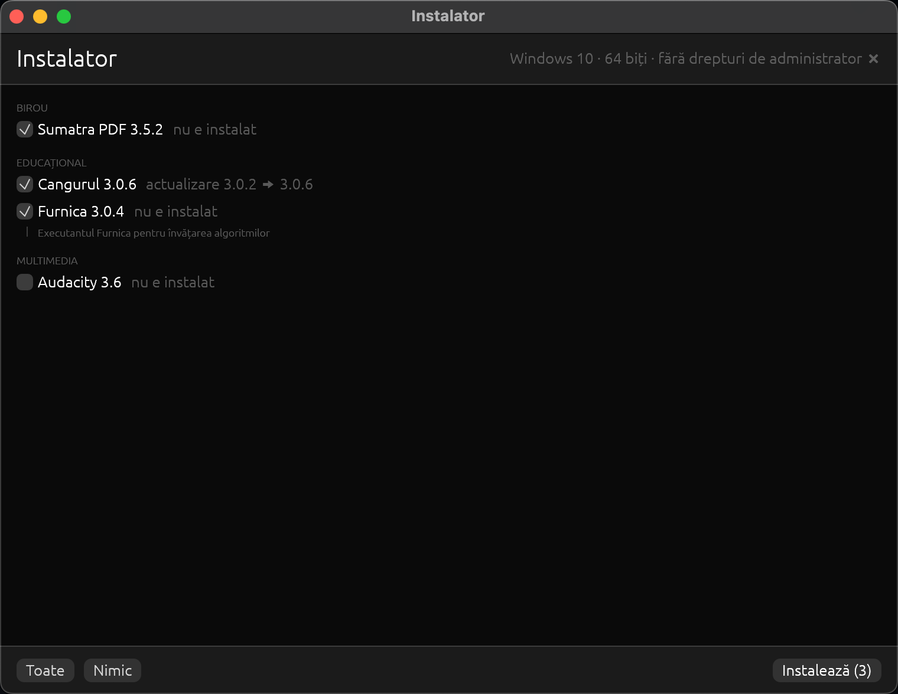

# Instalator

Un program care pornește de pe stick pe orice calculator (Windows 8 / 8.1 /
10 / 11, 32 și 64 de biți; Linux pe 64 de biți: Ubuntu, Linux Mint, Q4OS, antiX) și instalează
sau actualizează programele de pe stick, fără să apăsați „Next” în fiecare installer.

Arhivele gata de pus pe stick sunt pe pagina [Releases](../../releases):
`instalator-<versiune>-windows.zip` și `instalator-<versiune>-linux.zip`.



1. Introduceți stick-ul și porniți `Instalator.exe`. Windows cere drepturi de administrator.
2. Programele lipsă și cele cu o versiune mai veche sunt bifate de la sine, iar cele la zi nu.
3. Apăsați **Instalează**. Programele se instalează pe rând, lângă fiecare apare ✔ sau ❌,
   iar la sfârșit vedeți un rezumat. O eroare la un program nu le oprește pe celelalte.
4. Ce s-a întâmplat pe fiecare calculator rămâne în `jurnal\<CALCULATOR>-<dată-oră>.txt`.

## Ce este pe stick

```
Instalator.exe
CITESTE.txt
soft-gl\                 OpenGL software pentru calculatoarele fără driver video
jurnal\                  creat de instalator
Windows\
  Furnica\
    program.toml
    furnica-3.0.5-windows7-x86-portable.zip
  Cangurul\
    program.toml
    cangurul-3.0.6-windows7-x86-portable.zip
  Sumatra PDF\
    program.toml
    SumatraPDF-3.5.2-64-install.exe
```

Instalatorul caută totul lângă `Instalator.exe`, deci litera stick-ului nu contează.

## Cum adaug un program

Creați o mapă în `Windows\`, puneți în ea installer-ul și un fișier `program.toml`.
Fișierul se scrie în UTF-8 (Notepad: „Salvare ca” → Codificare UTF-8).

```toml
name = "Sumatra PDF"            # cum apare în listă
version = "3.5.2"               # versiunea installer-ului de pe stick
category = "Birou"              # programele se grupează după categorie
description = "Cititor PDF"     # opțional
default = true                  # opțional (implicit true): bifat pe calculatoarele unde lipsește

[detect]                        # obligatoriu pentru msi și exe
registry_name = "SumatraPDF"    # începutul numelui din „Programe și caracteristici”

[[variant]]                     # una sau mai multe variante
windows = ["8", "10"]           # "8" = Windows 8 și 8.1, "10" = Windows 10 și 11
arch = "x64"                    # "x86" sau "x64"; pe 64 de biți merge și o variantă x86
kind = "exe"                    # "msi", "exe" sau "zip"
file = "SumatraPDF-3.5.2-64-install.exe"
args = ["-s", "-all-users"]     # cheile pentru instalarea fără ferestre
```

Câmpuri suplimentare pentru `[[variant]]`, toate opționale:

| câmp | implicit | ce face |
|---|---|---|
| `args` | `[]` | argumentele installer-ului; la `msi` se adaugă după `/i <fișier> /qn /norestart` |
| `success_codes` | `[0]` | codurile de ieșire care înseamnă „reușit” |
| `reboot_codes` | `[3010, 1641]` | coduri care înseamnă „reușit, cere repornire” |
| `timeout_min` | `30` | după atâtea minute installer-ul e oprit și primește ❌ |
| `target` | — | doar `zip`: mapa în care se dezarhivează (obligatoriu) |
| `shortcut` | — | doar `zip`: `.exe`-ul din `target` pentru scurtătură (obligatoriu) |
| `desktop` | `true` | doar `zip`: scurtătură și pe desktop, nu doar în meniul Start |

Un `program.toml` greșit nu oprește instalatorul: programul apare în listă cu eroarea scrisă
cu roșu.

### Cum aflu cheile silențioase

Fiecare producător folosește alt tip de installer. Cel mai sigur e să căutați în
documentația lui „silent install”. De obicei:

| installer | cum îl recunoașteți | `args` |
|---|---|---|
| MSI | fișier `.msi` | nimic (instalatorul adaugă `/qn /norestart`) |
| Inno Setup | `setup.exe /?` arată o fereastră „Setup” cu `/VERYSILENT` | `["/VERYSILENT", "/NORESTART", "/SUPPRESSMSGBOXES"]` |
| NSIS | fereastra are jos „Nullsoft Install System” | `["/S"]` |
| altele | `setup.exe /?` în linia de comandă | ce scrie acolo |

Încercați o dată de mână, într-o linie de comandă pornită ca administrator:
`setup.exe /VERYSILENT /NORESTART`. Dacă nu apare nicio fereastră și programul se instalează,
cheile sunt bune. Un installer care, în ciuda cheilor, deschide o fereastră va fi oprit după
`timeout_min` minute.

### Cum aflu `registry_name`

Instalați programul o dată de mână și uitați-vă în Panou de control → Programe și
caracteristici: numele din listă este `DisplayName`, iar versiunea e `DisplayVersion`.
`registry_name` este începutul acestui nume (fără diferență între litere mari și mici), de
exemplu `"Audacity"` pentru „Audacity 3.6.4”. Din linia de comandă:

```
reg query HKLM\SOFTWARE\Microsoft\Windows\CurrentVersion\Uninstall /s /f Audacity
reg query HKLM\SOFTWARE\WOW6432Node\Microsoft\Windows\CurrentVersion\Uninstall /s /f Audacity
```

### Exemple

Un installer Inno Setup (Audacity):

```toml
name = "Audacity"
version = "3.6.4"
category = "Multimedia"
description = "Editor audio"

[detect]
registry_name = "Audacity"

[[variant]]
windows = ["10"]
arch = "x64"
kind = "exe"
file = "audacity-win-3.6.4-64bit.exe"
args = ["/VERYSILENT", "/NORESTART", "/SUPPRESSMSGBOXES"]
```

Un MSI, cu variante separate pentru 32 și 64 de biți:

```toml
name = "Program"
version = "2.1.0"
category = "Birou"

[detect]
registry_name = "Program"

[[variant]]
windows = ["8", "10"]
arch = "x64"
kind = "msi"
file = "program-2.1.0-x64.msi"

[[variant]]
windows = ["8", "10"]
arch = "x86"
kind = "msi"
file = "program-2.1.0-x86.msi"
```

Un program portabil (`zip`) se dezarhivează în `target`. Versiunea instalată se ține în
`target\.instalator-versiune`, iar la actualizare mapa se înlocuiește cu totul. Dacă programul
e deschis, mapa veche rămâne neatinsă și programul primește ❌. Vedeți
`stick/Windows/Furnica/program.toml`.

## Linux

Pe stick-ul de Linux, mapa cu programe se numește `Linux/` și are aceeași structură. Pornire
dintr-un terminal (stick-urile FAT32 nu permit rularea directă a programelor):

```
sh /media/<utilizator>/<stick>/instalator.sh
```

Scriptul cere parola o singură dată (fereastra sistemului sau, pe antiX, `sudo` în terminal)
și pornește instalatorul ca root.

Tipuri de pachete (`kind`):

| `kind` | cum se instalează | versiunea instalată |
|---|---|---|
| `deb` | `apt-get install -y ./fișier.deb` (aduce și dependențele) | `dpkg-query` după `[detect] package` |
| `appimage` | se dezarhivează în `target` (implicit `/opt/<nume>`), apare în meniu | marcajul din `target` |
| `rpm` | `alien -i` (distribuțiile Debian nu au rpm nativ; cere `sudo apt install alien`) | `dpkg-query` după `[detect] package` |

Când un program are mai multe variante, se alege deb, apoi AppImage, apoi rpm. Pe Linux
câmpul `windows` lipsește. Exemplu:

```toml
name = "Furnica"
version = "3.0.5"
category = "Educațional"

[detect]
package = "furnica"        # numele pachetului: dpkg -l | grep furnica

[[variant]]
arch = "x64"
kind = "deb"
file = "furnica-3.0.5-linux-x86_64.deb"
```

## Construire

```
cargo test                                   # logica, pe orice sistem
packaging/windows/package.sh                 # dist/instalator-<versiune>-windows.zip
packaging/linux/package.sh                   # dist/instalator-<versiune>-linux.zip (pe Linux)
```

La fiecare push pe `main` cu o versiune nouă în `Cargo.toml`, workflow-ul
`.github/workflows/release.yml` construiește ambele arhive (cu Furnica și Cangurul descărcate
din release-urile lor) și publică release-ul `v<versiune>`.

`package.sh` merge pe macOS și pe Linux (`brew install mingw-w64 sevenzip zstd` sau
`apt install gcc-mingw-w64-i686 7zip zstd`). Construiește, ca și Cangurul, pentru ținta
`i686-win7-windows-gnu`: un Rust construit obișnuit cere Windows 10, iar acesta pornește și pe
Windows 8. Dacă `../furnica/dist/release` și `../cangurul/dist/release` conțin arhivele
`*-windows7-x86-portable.zip`, le copiază pe stick și actualizează `program.toml`.

Pentru dezvoltare: `cargo run -- stick/Windows` deschide fereastra cu programele din repo
(pe macOS nu se apasă „Instalează”: căile țintă sunt de Windows).
